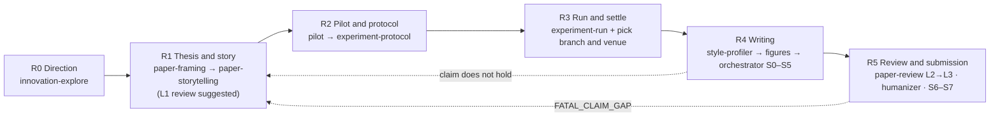

# research-paper-skills

[中文](README.md) | English

Stage-gated skills for Claude Code & Codex that take a research paper from idea to submission — thesis before experiments, no skipped stages.
A new session (local or cloud) should read [CONTEXT.md](CONTEXT.md) first: it records why the workflow is designed this way, which trade-offs are deliberate, and what is still open.

> **Language note.** The skills that ask the user to decide something (pipeline, direction, framing, story, review) are written in Chinese; the skills that operate on English manuscripts or wrap third-party tools are written in English. Every self-written skill has a bilingual `description`, so English trigger phrases work. File names, status values, and the section headings that scripts parse are constants and stay as they are in the templates. CONTEXT.md and AGENTS.md are in Chinese.

## Workflow

The entry point is `research-pipeline`. It determines the current stage, checks the gate, routes the work to the skill for that stage, and maintains `research/STATE.md` and `PROGRESS.md` inside the paper project. Every stage ends with a stop for the user's judgment; a problem found later that belongs to an earlier stage triggers an explicit rollback, not a patch.



| Stage | Goal | Outputs | Skill |
|---|---|---|---|
| R0 Direction | Pick and rank 2–3 directions worth doing and feasible; the topic entry transfers from literature, the anomaly entry rules out artifacts before characterizing the phenomenon | `docs/innovation-log.md` (one four-question potential card per direction) | `innovation-explore` |
| R1 Thesis and story | Before experiments: choose the research type; fix the claim, reader, RQs, decision rules, strongest baseline, potential card, and venue candidates; write a story spine with branches | `paper/FRAMING.md`, `paper/STORY_SPINE.md`, `paper/VENUE_PROFILE.md` | `paper-framing` → `paper-storytelling` (→ forward-looking L1 use of `paper-review`) |
| R2 Pilot and protocol | Pilot at small scale to set thresholds and branches, then freeze the protocol per research-type profile: objects and data, comparison or analysis, decision rules for three outcomes, robustness, result-neutral checks, fingerprints, authorization | `experiments/PILOT_<date>.md`, `experiments/PROTOCOL_<date>.md` | `research-pipeline/references/pilot-protocol.md`, `experiment-protocol.md`, seven research-type profiles in `methods/` |
| R3 Run and settle | Run per protocol, produce RESULT.md and the ledger, log deviations; pick the story branch and venue from the ledger | `reports/<run>/RESULT.md`, `paper/ledger/`, spine settlement and archive | `research-pipeline/references/experiment-run.md`, `when-results-disappoint.md` + the project's own execution setup |
| R4 Writing | Style anchors and figures first, then the body following the spine | `paper/FIGURE_PLAN.md`, `.paper-style/`, `paper/manuscript/`, `paper/state.json` | `paper-style-profiler` → `publication-chart-skill` / `scientific-visualization` → `paper-writing-orchestrator` (uses `paper-storytelling` and `academic-humanizer` internally) |
| R5 Review and submission | Graded review, revision, artifact, submission package | `paper/review/`, artifact | `paper-review` (per venue profile), `academic-humanizer`, orchestrator S6–S7 |

How the R stages connect to the orchestrator's S0–S7 (S1 inherits the R3 ledger; S2 inherits FRAMING and the spine and adds the figure plan, style contract, and spine re-check) is in [orchestrator-mapping.md](.claude/skills/research-pipeline/references/orchestrator-mapping.md). Auxiliary skill: `paper-reading` (in-depth paper reading reports).

## Files in a paper project

```
research/STATE.md               the single stage state (shared by Claude and Codex)
PROGRESS.md                     task table and handoff
docs/innovation-log.md          R0
paper/FRAMING.md                R1
paper/STORY_SPINE.md            R1 (with holds / does-not-hold branches), settled after R3; R1 version archived as STORY_SPINE_R1_<date>.md
paper/VENUE_PROFILE.md          candidates in R1, decided after R3
experiments/PILOT_<date>.md     R2a pilot (exploratory, may be waived)
experiments/PROTOCOL_<date>.md  R2b confirmatory protocol; after freezing only addenda are appended
reports/<run>/RESULT.md         R3
paper/ledger/                   produced in R3, only inherited in R4
paper/FIGURE_PLAN.md            R4, figures before text
.paper-style/                   R4 style contract
paper/manuscript/               R4
paper/state.json                orchestrator S0–S7
paper/review/                   R5
```

## Quick start

```bash
./install.sh            # symlink into ~/.claude/skills and ~/.codex/skills; existing entries are skipped, --force replaces old symlinks, --copy copies
P=.claude/skills/research-pipeline
python3 $P/scripts/init_paper_project.py ~/papers/my-paper --paper-id my-paper --venue UNDECIDED   # create the project skeleton, never overwrites existing files
python3 $P/scripts/check_gates.py ~/papers/my-paper                                          # file-level gate check; exit code 1 means open items, not an error
```

Then, inside the paper project, ask Claude or Codex to "use research-pipeline to determine the stage". It reads STATE.md, runs check_gates, reports the stage and the next skill to call, and stops for you. A new project's next step is R0's `innovation-explore`: it sets disable-model-invocation, so the model will not enter it for you; trigger it yourself with `/innovation-explore` (`$innovation-explore` in Codex). A project whose experiments are already done enters through the five steps of [results-first-entry.md](.claude/skills/research-pipeline/references/results-first-entry.md), with timing recorded truthfully. An existing project with its own file layout does not need renaming: `init_paper_project.py <dir> --state-only` creates only the two state files; write `default path → actual path` in the stage output index of STATE.md and check_gates follows the index (format in [state-template.md](.claude/skills/research-pipeline/references/state-template.md)).

Opening Claude Code inside this repository discovers the skills under `.claude/skills/` automatically; for other projects, install them at user level with `install.sh`.

## Skills

| Skill | Stage | Responsibility | Language |
|---|---|---|---|
| `research-pipeline` | Entry point | Determine stage, check gates, route, maintain STATE / PROGRESS; project skeleton and gate-check scripts | zh |
| `innovation-explore` | R0 | Stage-locked, progressively disclosed exploration of innovation points; topic and anomaly entries. Sets disable-model-invocation, so you trigger it yourself with `/innovation-explore`; the model cannot invoke it | zh |
| `paper-framing` | R1 (also post hoc) | Claim, RQs, decision rules, strongest baseline, competing explanations, reader visibility | zh |
| `paper-storytelling` | R1 / R4 | Story spine, six-step introduction, Figure 1, RQ answer boxes, lab-report symptom checklist | zh |
| `paper-style-profiler` | R4 | Extract a style contract from strong published papers in the repository | en |
| `publication-chart-skill` | R4 | Figure-vs-table decisions and the pubfig / pubtab route (third party, minor changes) | en |
| `scientific-visualization` | R4 | Honest encoding, accessibility, export, and audit of data figures (third party, minor changes) | en |
| `paper-writing-orchestrator` | R4–R5 | Manuscript S0–S7 stage gates, ledger contract, figure quality gate, review routing | en |
| `academic-humanizer` | R4–R5 | Fact-preserving revision of academic prose (third party, compass-skills, minor changes) | en (with Chinese rules) |
| `drawio-skill` | R4 | Method / architecture / flow diagrams as editable .drawio (third party) | en |
| `paper-review` | L1 in R1 / R5 | Graded review L1–L3: a venue-independent core plus venue profiles (none bundled; one file per venue, written from the template) | zh |
| `paper-reading` | Auxiliary | Graduate-level paper reading reports | en (report structure in Chinese) |
| `task-forest` | Auxiliary | Repo-local task DAG and session close-out (third party, compass-skills) | en |
| `session-handoff-prompt` | Auxiliary | Continuation prompt for a fresh session (third party, compass-skills) | en |

## Rules built into the workflow

Thesis before experiments; every outcome has somewhere to go (spine branches + result-neutral checks); the baseline is the current strongest version; decision rules carry robustness requirements; a venue changes only the reader and the takeaway; the ledger is produced in R3 and only inherited in R4; additional analyses are recorded separately and never promoted to protocol conclusions; figures first; the story never changes the evidence; progressive disclosure; authorization comes only from the user's specific decisions; review looks at the rendered PDF. The reasons and the full list are in [CONTEXT.md](CONTEXT.md).

## Maintenance

- After changing a skill, run `python3 scripts/validate_skills.py`: it checks each SKILL.md frontmatter, that relative links resolve, that there are no private paths, and that evals.json parses. CI ([validate.yml](.github/workflows/validate.yml)) runs it on every push and pull request, together with smoke tests of the project scripts and `install.sh`.
- Language follows purpose: skills that ask the user to decide are in Chinese; skills that operate on English manuscripts or wrap third-party tools are in English; every description carries both Chinese and English trigger phrases. The rule is in [AGENTS.md](AGENTS.md).
- Review has a single skill, `paper-review`; add a new venue by writing one profile from the template in [venues/README.md](.claude/skills/paper-review/references/venues/README.md).
- Third-party skills use the pinned upstream commit as their baseline; the existing minor changes are listed one by one in THIRD_PARTY_NOTICES.md and no new changes are made; the pinned versions are in [external-skill-locks.md](.claude/skills/paper-writing-orchestrator/references/external-skill-locks.md).
- New rules go into CONTEXT.md first, then into the relevant SKILL.md; eval cases live in each skill's `evals/evals.json`.
- Codex reads [AGENTS.md](AGENTS.md), Claude Code reads [CLAUDE.md](CLAUDE.md); both are the same conventions. A suggested "Research stage lock" for your global instructions is in [docs/global-instructions-snippet.md](docs/global-instructions-snippet.md).

## Status

The eval cases in each skill's `evals/evals.json` have been written but not yet run as baseline comparisons. Expect the workflow and templates to change.

## License

- The self-written skills, scripts, and documentation in this repository are released under the MIT license; see [LICENSE](LICENSE).
- The six bundled third-party skills are each MIT-licensed: `scientific-visualization` (K-Dense Inc.), `publication-chart-skill` (Gaorui Zhang), `drawio-skill` (Agents365-ai), `academic-humanizer`, `task-forest`, `session-handoff-prompt` (COMPASS Skills contributors). Copyright notices, full license texts, pinned upstream commits, and the minor changes to `scientific-visualization`, `publication-chart-skill`, and `academic-humanizer` are in [THIRD_PARTY_NOTICES.md](THIRD_PARTY_NOTICES.md).
- Skills referenced in the routing tables but not bundled (`$pdf`, `$jupyter-notebook`, `$academic-paper-ppt`, `$review-paper`) must be installed separately; without them the corresponding route is skipped.
