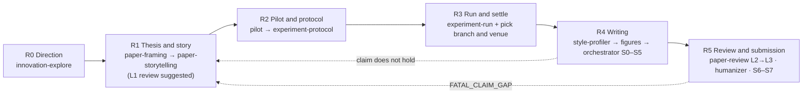

<div align="center">

# research-paper-skills

**Stage-gated skills for Claude Code & Codex that take a research paper from idea to submission.**<br/>
Thesis before experiments. No skipped stages. The story never changes the evidence.

[](LICENSE)
[](https://github.com/unravel11/research-paper-skills/actions/workflows/validate.yml)
[](#whats-inside)
[](#install)
[](#install)

English | [中文](README.zh-CN.md)

</div>

---

Most papers that struggle in review don't have a data problem. They have a process problem: the main comparison was chosen after the test results came in, the draft reads like a lab report instead of a story, and the central result has no figure. These skills turn the whole path, from choosing a direction to submitting, into six gated stages. Each stage produces files, a script checks the gate, and the agent stops for your judgment before moving on.

## Contents

- [How it works](#how-it-works)
- [Install](#install)
- [Quick start](#quick-start)
- [Try it](#try-it)
- [What's inside](#whats-inside)
- [Ground rules](#ground-rules)
- [FAQ](#faq)
- [Contributing](#contributing)
- [License and credits](#license-and-credits)

## How it works



`research-pipeline` is the single entry point. It determines the current stage from the files on disk (never from the conversation), checks the gate, routes the work to the right skill, and keeps `research/STATE.md` and `PROGRESS.md` up to date.

1. **R0 Direction**: `innovation-explore` ranks two or three directions worth doing. It has a topic entry, which transfers ideas from the literature, and an anomaly entry, which rules out artifacts before treating an odd observation as a phenomenon. You trigger it yourself.
2. **R1 Thesis and story**: `paper-framing` fixes the claim, reader, RQs, decision rules and the strongest baseline *before any experiment*. `paper-storytelling` then writes a story spine with two branches, one for "it holds" and one for "it doesn't".
3. **R2 Pilot and protocol**: run a small pilot, then freeze a protocol with decision rules for all three outcomes, robustness requirements and result-neutral checks. Seven research-type profiles cover controlled experiments, measurement studies, tool evaluations, qualitative work, human-subject studies, formal work and replications.
4. **R3 Run and settle**: run per protocol, build the evidence ledger, log deviations, then pick the story branch and the venue from the ledger.
5. **R4 Writing**: style anchors and figures come first, then `paper-writing-orchestrator` drafts the body against the spine.
6. **R5 Review and submission**: `paper-review` runs graded L2 → L3 reviews against a venue profile, followed by fact-preserving revision and the submission package.

When a later stage exposes a problem from an earlier one, the pipeline rolls back explicitly instead of patching it in the prose.

<details>
<summary><b>Stage gates and outputs</b></summary>

| Stage | Goal | Outputs | Skill |
|---|---|---|---|
| R0 Direction | Pick and rank 2–3 directions worth doing and feasible | `docs/innovation-log.md` (one four-question potential card per direction) | `innovation-explore` |
| R1 Thesis and story | Choose the research type; fix claim, reader, RQs, decision rules, strongest baseline, potential card, venue candidates; write a branched story spine | `paper/FRAMING.md`, `paper/STORY_SPINE.md`, `paper/VENUE_PROFILE.md` | `paper-framing` → `paper-storytelling` (→ forward-looking L1 `paper-review`) |
| R2 Pilot and protocol | Pilot to set thresholds and branches, then freeze objects and data, comparison or analysis, decision rules for three outcomes, robustness, result-neutral checks, fingerprints, authorization | `experiments/PILOT_<date>.md`, `experiments/PROTOCOL_<date>.md` | `research-pipeline` references: `pilot-protocol.md`, `experiment-protocol.md`, `methods/` |
| R3 Run and settle | Run per protocol, write RESULT.md and the ledger, log deviations; pick the story branch and venue | `reports/<run>/RESULT.md`, `paper/ledger/`, settled spine | `experiment-run.md`, `when-results-disappoint.md` + your own execution setup |
| R4 Writing | Style anchors and figures first, then the body following the spine | `paper/FIGURE_PLAN.md`, `.paper-style/`, `paper/manuscript/`, `paper/state.json` | `paper-style-profiler` → `publication-chart-skill` / `scientific-visualization` → `paper-writing-orchestrator` |
| R5 Review and submission | Graded review, revision, artifact, submission package | `paper/review/`, artifact | `paper-review`, `academic-humanizer`, orchestrator S6–S7 |

How the R stages map onto the orchestrator's S0–S7 is in [orchestrator-mapping.md](.claude/skills/research-pipeline/references/orchestrator-mapping.md).

</details>

<details>
<summary><b>Files in a paper project</b></summary>

```
research/STATE.md               the single stage state (shared by Claude and Codex)
PROGRESS.md                     task table and handoff
docs/innovation-log.md          R0
paper/FRAMING.md                R1
paper/STORY_SPINE.md            R1 (holds / does-not-hold branches), settled after R3
paper/VENUE_PROFILE.md          candidates in R1, decided after R3
experiments/PILOT_<date>.md     R2a pilot (exploratory, may be waived)
experiments/PROTOCOL_<date>.md  R2b confirmatory protocol; frozen, only addenda appended
reports/<run>/RESULT.md         R3
paper/ledger/                   produced in R3, only inherited in R4
paper/FIGURE_PLAN.md            R4, figures before text
.paper-style/                   R4 style contract
paper/manuscript/               R4
paper/state.json                orchestrator S0–S7
paper/review/                   R5
```

</details>

## Install

```bash
git clone https://github.com/unravel11/research-paper-skills.git
cd research-paper-skills
./install.sh
```

`install.sh` symlinks every skill into both `~/.claude/skills` (Claude Code) and `~/.codex/skills` (Codex). Existing entries are skipped. Pass `--force` to replace old symlinks, or `--copy` to copy instead of linking. Opening Claude Code inside this repository also discovers the skills under `.claude/skills/` directly.

Requires Python 3 for the project scripts. `drawio-skill` additionally needs the draw.io desktop CLI.

## Quick start

```bash
P=.claude/skills/research-pipeline/scripts
python3 $P/init_paper_project.py ~/papers/my-paper --paper-id my-paper --venue UNDECIDED  # skeleton; never overwrites files
python3 $P/check_gates.py ~/papers/my-paper                                              # exit code 1 = open gate items, not an error
```

Then, inside the paper project, ask your agent:

> Use research-pipeline to determine the stage of this paper.

It reads `STATE.md`, runs `check_gates`, reports the stage and the next skill, and stops. For a new project the next step is R0. Type `/innovation-explore` yourself (`$innovation-explore` in Codex). The skill sets `disable-model-invocation`, so the agent never enters it on its own.

- **Experiments already done?** Enter through the five steps of [results-first-entry.md](.claude/skills/research-pipeline/references/results-first-entry.md). The timing is recorded truthfully.
- **Existing project with its own layout?** Run `init_paper_project.py <dir> --state-only` and map `default path → actual path` in the stage output index of `STATE.md` (see [state-template.md](.claude/skills/research-pipeline/references/state-template.md)). Nothing gets renamed.

## Try it

| You want to… | Say to the agent | Skill |
|---|---|---|
| Know where the paper stands | "Where is this paper? What's the next step?" | `research-pipeline` |
| Find a direction | type `/innovation-explore` | `innovation-explore` |
| Lock the thesis before experiments | "Define the thesis, RQs and decision rules before we run anything." | `paper-framing` |
| Get a two-minute contribution summary | "What is this paper's main contribution, and what can't we claim?" | `paper-framing` |
| Fix a draft that reads like a lab report | "The reviewers say it's incremental. Rework the story." | `paper-storytelling` |
| Get a go / no-go before submitting | "Give this paper an L3 pre-submission review for TSE." | `paper-review` |
| Make a paper-ready figure | "Turn these results into a publication-quality figure." | `scientific-visualization` |
| Remove formulaic phrasing | "De-AI this abstract without changing any claim." | `academic-humanizer` |

## What's inside

**Pipeline and direction**

| Skill | What it does | Lang |
|---|---|---|
| [`research-pipeline`](.claude/skills/research-pipeline/SKILL.md) | Entry point: determines the stage, checks gates, routes, maintains STATE / PROGRESS; ships the skeleton and gate-check scripts | zh |
| [`innovation-explore`](.claude/skills/innovation-explore/SKILL.md) | R0: stage-locked, progressively disclosed search for directions; topic and anomaly entries; user-triggered only | zh |

**Thesis and story**

| Skill | What it does | Lang |
|---|---|---|
| [`paper-framing`](.claude/skills/paper-framing/SKILL.md) | Claim, RQs, decision rules, strongest baseline, competing explanations, reader value, contribution brief | zh |
| [`paper-storytelling`](.claude/skills/paper-storytelling/SKILL.md) | Branched story spine, six-step introduction, Figure 1, RQ answer boxes, lab-report symptom checklist | zh |

**Writing and figures**

| Skill | What it does | Lang |
|---|---|---|
| [`paper-writing-orchestrator`](.claude/skills/paper-writing-orchestrator/SKILL.md) | Manuscript stages S0–S7, ledger contract, figure quality gate, review routing | en |
| [`paper-style-profiler`](.claude/skills/paper-style-profiler/SKILL.md) | Extracts a style contract from strong published papers already in your repository | en |
| [`scientific-visualization`](.claude/skills/scientific-visualization/SKILL.md) † | Honest encoding, accessibility, export and audit of data figures | en |
| [`publication-chart-skill`](.claude/skills/publication-chart-skill/SKILL.md) † | Figure-vs-table decisions; the pubfig / pubtab route | en |
| [`drawio-skill`](.claude/skills/drawio-skill/SKILL.md) † | Method and architecture diagrams as editable `.drawio` | en |
| [`academic-humanizer`](.claude/skills/academic-humanizer/SKILL.md) † | Fact-preserving revision of academic prose | en |

**Review and reading**

| Skill | What it does | Lang |
|---|---|---|
| [`paper-review`](.claude/skills/paper-review/SKILL.md) | Graded review: L1 thesis and potential, L2 evidence chain, L3 simulated review; venue-neutral core plus one profile per venue | zh |
| [`paper-reading`](.claude/skills/paper-reading/SKILL.md) | Graduate-level reading reports for one or more papers | en |

**Session utilities**

| Skill | What it does | Lang |
|---|---|---|
| [`task-forest`](.claude/skills/task-forest/SKILL.md) † | Repo-local task DAG and session close-out | en |
| [`session-handoff-prompt`](.claude/skills/session-handoff-prompt/SKILL.md) † | Continuation prompt for a fresh session | en |

† Bundled third-party skill, pinned to an upstream commit. See [License and credits](#license-and-credits).

## Ground rules

These are built into the skills. They are not suggestions.

- **Thesis before experiments.** The baseline is the current strongest version, never an old one.
- **Every outcome has somewhere to go.** The spine has two branches, the protocol has result-neutral checks, and a negative result is a finding.
- **Derive before you test.** If existing numbers already answer a comparison, it is not a main comparison.
- **Decision rules carry robustness requirements**, written per research type.
- **A venue changes only the reader and the takeaway**, never the comparisons, rules or claim strength.
- **The ledger is built in R3 and only inherited in R4.** Every number in the text traces to an output file.
- **Additional analyses stay separate.** They are called "analyses", never "validation".
- **Figures first, and the story never changes the evidence.**
- **Authorization comes only from you.** Training, API calls, real data, protected sets, submission and anything sent outside each need your explicit go-ahead.
- **Review looks at the rendered PDF**, not just the source.

The reasoning behind each rule is in [CONTEXT.md](CONTEXT.md).

## FAQ

**Some skills are written in Chinese. Can I use them in English?**
Yes. Every self-written skill has a bilingual `description`, so English requests trigger them, and the agent answers in your language. The section headings inside the generated templates stay as they are because `check_gates.py` parses them.

**Will it run experiments or write the paper for me?**
It plans, checks, routes and drafts against your evidence. It never runs training, API calls or real data without your authorization, and it never invents evidence or strengthens a claim beyond what the ledger supports.

**Which venues are supported?**
The review core is venue-neutral. Add a venue by writing one profile from the template in [venues/README.md](.claude/skills/paper-review/references/venues/README.md). Without a profile, the generic rubric plus an official-source check is used.

**Can I use only some of the skills?**
Yes. Each skill is a self-contained folder. Copy the ones you want into `~/.claude/skills` or `~/.codex/skills`.

**Can I make the stage lock global?**
Paste the snippet in [docs/global-instructions-snippet.md](docs/global-instructions-snippet.md) into your global `CLAUDE.md` or `AGENTS.md`.

## Contributing

Issues and pull requests are welcome.

1. Propose a new rule in an issue first. Accepted rules go into [CONTEXT.md](CONTEXT.md) before they reach a `SKILL.md`.
2. Keep each `description` bilingual, with Chinese and English trigger phrases.
3. Add a venue as a single file under `paper-review/references/venues/`. Don't create a separate review skill for it.
4. Don't edit bundled third-party skills. Adjust their behavior from the calling skill instead.
5. Run `python3 scripts/validate_skills.py` before opening a PR. CI runs it, plus smoke tests of the scripts and `install.sh`.

Conventions for agents working on this repository are in [AGENTS.md](AGENTS.md). Claude Code reads them through [CLAUDE.md](CLAUDE.md).

**Status:** the eval cases in each skill's `evals/evals.json` are written but have not yet been run as baseline comparisons. Expect the workflow and templates to change.

## License and credits

The self-written skills, scripts and docs are released under the [MIT License](LICENSE).

The bundled third-party skills are MIT-licensed by their authors. Copyright notices, full license texts, pinned commits and every local change are listed in [THIRD_PARTY_NOTICES.md](THIRD_PARTY_NOTICES.md).

| Skill | Upstream |
|---|---|
| `scientific-visualization` | [K-Dense-AI/scientific-agent-skills](https://github.com/K-Dense-AI/scientific-agent-skills) |
| `publication-chart-skill` | [Galaxy-Dawn/claude-scholar](https://github.com/Galaxy-Dawn/claude-scholar) |
| `drawio-skill` | [Agents365-ai/drawio-skill](https://github.com/Agents365-ai/drawio-skill) |
| `academic-humanizer`, `task-forest`, `session-handoff-prompt` | [dongshuyan/compass-skills](https://github.com/dongshuyan/compass-skills) |

Skills that are referenced in routing tables but not bundled (`$pdf`, `$jupyter-notebook`, `$academic-paper-ppt`, `$review-paper`, `$Spreadsheets`) must be installed separately. Without them, the corresponding route is skipped.
