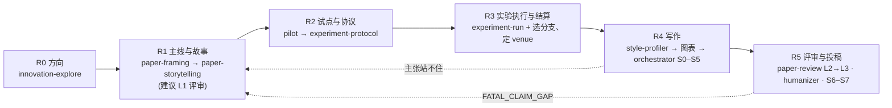

# research-paper-skills

中文 | [English](README.en.md)

分阶段、带门槛的科研论文 skill，Claude Code 与 Codex 共用同一份：把一篇论文从确定方向一路带到投稿，先定主线再做实验，不跳阶段。
新会话（本地或云端）先读 [CONTEXT.md](CONTEXT.md)：它记录这套流程为什么这样设计、哪些取舍是有意的、哪些事还没定。

## 流程

入口是 `research-pipeline`。它判定阶段、核对门槛、把工作路由到对应阶段的 skill，并维护论文项目内的 `research/STATE.md` 与 `PROGRESS.md`。每个阶段结束停下等用户判断；后一阶段发现前一阶段的问题就明确回退，不打补丁。



| 阶段 | 目标 | 产出 | skill |
|---|---|---|---|
| R0 方向 | 选出 2–3 个值得做、条件允许的方向并排序；主题入口读文献迁移，异常入口先排伪像再刻画现象 | `docs/innovation-log.md`（每个方向一张四问潜力卡） | `innovation-explore` |
| R1 主线与故事 | 实验前选定研究类型，定主张、读者、RQ、判定规则、最强基线、潜力卡与 venue 候选；写带分支的故事骨架 | `paper/FRAMING.md`、`paper/STORY_SPINE.md`、`paper/VENUE_PROFILE.md` | `paper-framing` → `paper-storytelling`（→ `paper-review` 的 L1 前瞻用法） |
| R2 试点与实验协议 | 先小规模试做定阈值与分支，再按研究类型档案冻结协议：对象与数据、比较或分析、三种结局的判定规则、稳健性要求、结果中性检查、指纹、授权 | `experiments/PILOT_<date>.md`、`experiments/PROTOCOL_<date>.md` | `research-pipeline/references/pilot-protocol.md`、`experiment-protocol.md`、`methods/` 七种研究类型档案 |
| R3 实验执行与结算 | 按协议做，生成 RESULT.md 与台账，登记偏离；按台账选定故事分支与 venue | `reports/<run>/RESULT.md`、`paper/ledger/`、骨架结算与归档 | `research-pipeline/references/experiment-run.md`、`when-results-disappoint.md` + 项目自己的执行方式 |
| R4 写作 | 先风格锚点与图表，再按骨架写正文 | `paper/FIGURE_PLAN.md`、`.paper-style/`、`paper/manuscript/`、`paper/state.json` | `paper-style-profiler` → `publication-chart-skill` / `scientific-visualization` → `paper-writing-orchestrator`（内部用 `paper-storytelling`、`academic-humanizer`） |
| R5 评审与投稿 | 分级评审、修订、artifact、投稿材料 | `paper/review/`、artifact | `paper-review`（按 venue 档案）、`academic-humanizer`、orchestrator S6–S7 |

R 阶段与 orchestrator 的 S0–S7 怎样衔接（S1 继承 R3 的台账；S2 继承 FRAMING 与骨架，并追加图表计划、风格合同、骨架复核），见 [orchestrator-mapping.md](.claude/skills/research-pipeline/references/orchestrator-mapping.md)。辅助 skill：`paper-reading`（文献精读报告）。

## 一篇论文项目里的文件

```
research/STATE.md               唯一阶段状态（Claude 与 Codex 共用）
PROGRESS.md                     任务表与交接
docs/innovation-log.md          R0
paper/FRAMING.md                R1
paper/STORY_SPINE.md            R1（带成立 / 不成立分支），R3 后结算；R1 版本归档为 STORY_SPINE_R1_<date>.md
paper/VENUE_PROFILE.md          R1 列候选，R3 后定
experiments/PILOT_<date>.md     R2a 试点（exploratory，可免）
experiments/PROTOCOL_<date>.md  R2b 确认协议，冻结后只追加补充协议
reports/<run>/RESULT.md         R3
paper/ledger/                   R3 生成，R4 只继承
paper/FIGURE_PLAN.md            R4，先图后文
.paper-style/                   R4 风格合同
paper/manuscript/               R4
paper/state.json                orchestrator S0–S7
paper/review/                   R5
```

## 快速开始

```bash
./install.sh            # 符号链接到 ~/.claude/skills 与 ~/.codex/skills；已有同名条目跳过，--force 替换旧符号链接，--copy 复制
P=.claude/skills/research-pipeline
python3 $P/scripts/init_paper_project.py ~/papers/my-paper --paper-id my-paper --venue UNDECIDED   # 建项目骨架，不覆盖已有文件
python3 $P/scripts/check_gates.py ~/papers/my-paper                                          # 文件级门槛核对；退出码 1 表示有未过项，不是报错
```

然后在论文项目里对 Claude 或 Codex 说"用 research-pipeline 判定阶段"。它读 STATE.md、跑 check_gates、报告阶段与下一步应调用的 skill，然后停下等你。新项目的下一步是 R0 的 `innovation-explore`：它设了 disable-model-invocation，模型不会代你进入，由你自己输入 `/innovation-explore`（Codex 里 `$innovation-explore`）触发。实验已经做完的项目按 [results-first-entry.md](.claude/skills/research-pipeline/references/results-first-entry.md) 的五步进入，时点如实标注。已经有自己一套文件的老项目不用改名：`init_paper_project.py <目录> --state-only` 只建两份状态文件，在 STATE.md 的阶段产出索引里写 `默认路径 → 实际路径`，check_gates 就按索引找（写法见 [state-template.md](.claude/skills/research-pipeline/references/state-template.md)）。

在本仓库内直接打开 Claude Code，`.claude/skills/` 下的 skill 会被自动发现；其他项目用 `install.sh` 安装到用户级目录。

## skill 清单

| skill | 阶段 | 职责 | 语言 |
|---|---|---|---|
| `research-pipeline` | 总入口 | 判定阶段、核对门槛、路由、维护 STATE / PROGRESS；项目骨架与门槛核对脚本 | 中 |
| `innovation-explore` | R0 | 阶段锁 + 渐进式披露的创新点探讨；主题入口与异常入口。设了 disable-model-invocation，由你自己输入 `/innovation-explore` 触发，模型不能代为调用 | 中 |
| `paper-framing` | R1（也用于事后） | 主张、RQ、判定规则、最强基线、竞争解释、读者可见性 | 中 |
| `paper-storytelling` | R1 / R4 | 故事骨架、引言六步、图一、RQ 回答框、实验报告症状清单 | 中 |
| `paper-style-profiler` | R4 | 从仓库里的优秀论文提炼风格合同 | 英 |
| `publication-chart-skill` | R4 | 图 / 表决策与 pubfig / pubtab 路线（第三方，有小改） | 英 |
| `scientific-visualization` | R4 | 数据图的诚实编码、可达性、导出与审计（第三方，有小改） | 英 |
| `paper-writing-orchestrator` | R4–R5 | 稿件 S0–S7 阶段门、台账合同、图表质量门、评审分流 | 英 |
| `academic-humanizer` | R4–R5 | 保事实的学术文本修订（第三方，compass-skills，有小改） | 英（含中文规则） |
| `drawio-skill` | R4 | 方法 / 架构 / 流程示意图，产出可编辑的 .drawio（第三方） | 英 |
| `paper-review` | R1 的 L1 / R5 | 分级评审 L1–L3，venue 无关的核心加 venue 档案（不内置，按模板一个 venue 一个文件） | 中 |
| `paper-reading` | 辅助 | 研究生级论文精读报告 | 英（报告结构中文） |
| `task-forest` | 辅助 | 仓库内的任务 DAG 与会话收尾（第三方，compass-skills） | 英 |
| `session-handoff-prompt` | 辅助 | 生成给新会话的续接 prompt（第三方，compass-skills） | 英 |

## 固化进流程的规则

先主线再实验；每种结局都要有去处（骨架分支 + 结果中性检查）；基线是当前最强版本；判定规则带稳健性要求；venue 只改读者与收获；台账在 R3 生成、R4 只继承；补做的分析分开记录、不升格为协议内结论；图表优先；故事不改证据；渐进式披露；授权只来自用户的具体决定；评审要看渲染后的 PDF。来由与完整条目见 [CONTEXT.md](CONTEXT.md)。

## 维护

- 改完 skill 运行 `python3 scripts/validate_skills.py`：检查每个 SKILL.md 的头部、相对链接是否指到存在的文件、有没有私人路径、evals.json 能否解析。CI（[validate.yml](.github/workflows/validate.yml)）在每次 push 与 PR 时跑它，并冒烟测试项目脚本和 `install.sh`。
- 语言按用途分：要用户拍板的 skill 用中文，操作英文稿件或包第三方工具的用英文；每个 description 同时带中英文触发短语。规则在 [AGENTS.md](AGENTS.md)。
- 评审只有 `paper-review` 一个 skill，新 venue 按 [venues/README.md](.claude/skills/paper-review/references/venues/README.md) 的模板加一份档案即可。
- 第三方 skill 以上游锁定提交为基线，已有的小改逐条列在 THIRD_PARTY_NOTICES.md，不再新增改动；锁定的版本记在 [external-skill-locks.md](.claude/skills/paper-writing-orchestrator/references/external-skill-locks.md)。
- 新规则先写进 CONTEXT.md，再落到对应 SKILL.md；评估用例放在各 skill 的 `evals/evals.json`。
- Codex 读 [AGENTS.md](AGENTS.md)，Claude Code 读 [CLAUDE.md](CLAUDE.md)，两者是同一份约定。全局指令的 "Research stage lock" 建议文本见 [docs/global-instructions-snippet.md](docs/global-instructions-snippet.md)。

## 许可

- 本仓库自写的 skill、脚本与文档以 MIT 许可发布，见 [LICENSE](LICENSE)。
- 随附的六个第三方 skill 各自以 MIT 发布：`scientific-visualization`（K-Dense Inc.）、`publication-chart-skill`（Gaorui Zhang）、`drawio-skill`（Agents365-ai）、`academic-humanizer`、`task-forest`、`session-handoff-prompt`（COMPASS Skills contributors）。版权声明、许可全文、锁定的上游提交，以及对 `scientific-visualization`、`publication-chart-skill`、`academic-humanizer` 的小改，都在 [THIRD_PARTY_NOTICES.md](THIRD_PARTY_NOTICES.md)。
- 路由表里提到但未随附的 skill（`$pdf`、`$jupyter-notebook`、`$academic-paper-ppt`、`$review-paper`）需自行安装，没有安装时对应路由跳过。
