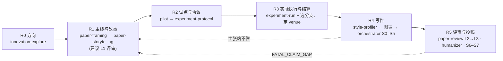

<div align="center">

# research-paper-skills

**分阶段、带门槛的科研论文 skill，Claude Code 与 Codex 共用：把一篇论文从确定方向一路带到投稿。**<br/>
先定主线再做实验，不跳阶段，故事不改证据。

[](LICENSE)
[](https://github.com/unravel11/research-paper-skills/actions/workflows/validate.yml)
[](#包含哪些-skill)
[](#安装)
[](#安装)

[English](README.md) | 中文

</div>

---

审稿时出问题的论文，多数不是数据有问题，而是流程有问题：主要比较是看到测试集结果之后才定的；初稿读起来像实验报告，不像故事；最核心的结果没有图。这套 skill 把"确定方向 → 投稿"拆成六个带门槛的阶段。每个阶段都要产出文件，由脚本核对门槛，过了门槛先停下来等你判断，再往下走。

## 目录

- [怎么运作](#怎么运作)
- [安装](#安装)
- [快速开始](#快速开始)
- [试试这些说法](#试试这些说法)
- [包含哪些 skill](#包含哪些-skill)
- [固化进流程的规则](#固化进流程的规则)
- [常见问题](#常见问题)
- [参与贡献](#参与贡献)
- [许可与致谢](#许可与致谢)

## 怎么运作



唯一入口是 `research-pipeline`。它按磁盘上的产出文件判定当前阶段（不看对话），核对门槛，把工作交给对应的 skill，并维护论文项目里的 `research/STATE.md` 与 `PROGRESS.md`。

1. **R0 方向**：`innovation-explore` 选出 2–3 个值得做的方向并排序。有两个入口：主题入口从文献迁移思路；异常入口先排除伪像，再把反常的观察当作现象来研究。由你自己触发。
2. **R1 主线与故事**：`paper-framing` 在**任何实验之前**定下主张、读者、RQ、判定规则和最强基线；`paper-storytelling` 再写故事骨架，分"成立"和"不成立"两个分支。
3. **R2 试点与协议**：先小规模试做，再冻结协议：三种结局各自的判定规则、稳健性要求、结果中性检查。七份研究类型档案覆盖受控实验与基准评测、测量研究、工具评估、案例与定性、以人为参与者的实验、形式化与理论、复现。
4. **R3 实验执行与结算**：按协议执行，生成证据台账，登记偏离；再按台账选定故事分支和 venue。
5. **R4 写作**：先定风格锚点和图表，再由 `paper-writing-orchestrator` 按骨架写正文。
6. **R5 评审与投稿**：`paper-review` 按 venue 档案做 L2 → L3 分级评审，然后做保事实的修订，最后准备投稿材料。

后一阶段发现前一阶段的问题时，明确回退到那个阶段去改，不在正文里打补丁。

<details>
<summary><b>各阶段门槛与产出</b></summary>

| 阶段 | 目标 | 产出 | skill |
|---|---|---|---|
| R0 方向 | 选出 2–3 个值得做、条件允许的方向并排序 | `docs/innovation-log.md`（每个方向一张四问潜力卡） | `innovation-explore` |
| R1 主线与故事 | 选定研究类型；定主张、读者、RQ、判定规则、最强基线、潜力卡与 venue 候选；写带分支的故事骨架 | `paper/FRAMING.md`、`paper/STORY_SPINE.md`、`paper/VENUE_PROFILE.md` | `paper-framing` → `paper-storytelling`（→ `paper-review` 的 L1 前瞻用法） |
| R2 试点与协议 | 试做定阈值与分支，再冻结对象与数据、比较或分析、三种结局的判定规则、稳健性、结果中性检查、指纹、授权 | `experiments/PILOT_<date>.md`、`experiments/PROTOCOL_<date>.md` | `research-pipeline` 的 `pilot-protocol.md`、`experiment-protocol.md`、`methods/` |
| R3 实验执行与结算 | 按协议做，写 RESULT.md 与台账，登记偏离；选定故事分支与 venue | `reports/<run>/RESULT.md`、`paper/ledger/`、结算后的骨架 | `experiment-run.md`、`when-results-disappoint.md` + 项目自己的执行方式 |
| R4 写作 | 先风格锚点与图表，再按骨架写正文 | `paper/FIGURE_PLAN.md`、`.paper-style/`、`paper/manuscript/`、`paper/state.json` | `paper-style-profiler` → `publication-chart-skill` / `scientific-visualization` → `paper-writing-orchestrator` |
| R5 评审与投稿 | 分级评审、修订、artifact、投稿材料 | `paper/review/`、artifact | `paper-review`、`academic-humanizer`、orchestrator S6–S7 |

R 阶段与 orchestrator 的 S0–S7 怎样衔接，见 [orchestrator-mapping.md](.claude/skills/research-pipeline/references/orchestrator-mapping.md)。

</details>

<details>
<summary><b>一篇论文项目里的文件</b></summary>

```
research/STATE.md               唯一阶段状态（Claude 与 Codex 共用）
PROGRESS.md                     任务表与交接
docs/innovation-log.md          R0
paper/FRAMING.md                R1
paper/STORY_SPINE.md            R1（带成立 / 不成立分支），R3 后结算
paper/VENUE_PROFILE.md          R1 列候选，R3 后定
experiments/PILOT_<date>.md     R2a 试点（exploratory，可免）
experiments/PROTOCOL_<date>.md  R2b 确认协议，冻结后只追加补充协议
reports/<run>/RESULT.md         R3
paper/ledger/                   R3 生成，R4 只继承
paper/FIGURE_PLAN.md            R4，先图后文
.paper-style/                   R4 风格合同
paper/manuscript/               R4
paper/state.json                orchestrator S0–S7
paper/review/                   R5
```

</details>

## 安装

```bash
git clone https://github.com/unravel11/research-paper-skills.git
cd research-paper-skills
./install.sh
```

`install.sh` 会把每个 skill 以符号链接的方式装到 `~/.claude/skills`（Claude Code）和 `~/.codex/skills`（Codex）。已有的同名条目会跳过；加 `--force` 替换旧的符号链接，加 `--copy` 改成复制。直接在本仓库里打开 Claude Code，也能自动发现 `.claude/skills/` 下的 skill。

项目脚本需要 Python 3；`drawio-skill` 还需要 draw.io 桌面版的命令行。

## 快速开始

```bash
P=.claude/skills/research-pipeline/scripts
python3 $P/init_paper_project.py ~/papers/my-paper --paper-id my-paper --venue UNDECIDED  # 建项目骨架，不覆盖已有文件
python3 $P/check_gates.py ~/papers/my-paper                                              # 退出码 1 表示有未过项，不是报错
```

然后在论文项目里对 agent 说：

> 用 research-pipeline 判定这篇论文现在在哪个阶段。

它会读 `STATE.md`、跑 `check_gates`，报告当前阶段和下一步该用的 skill，然后停下。新项目的下一步是 R0：你自己输入 `/innovation-explore`（Codex 里是 `$innovation-explore`）。这个 skill 设了 `disable-model-invocation`，agent 不会自己进入。

- **实验已经做完了？** 按 [results-first-entry.md](.claude/skills/research-pipeline/references/results-first-entry.md) 的五步进入，各步的时点如实记录。
- **老项目有自己的文件布局？** 运行 `init_paper_project.py <目录> --state-only`，在 `STATE.md` 的阶段产出索引里写 `默认路径 → 实际路径`（写法见 [state-template.md](.claude/skills/research-pipeline/references/state-template.md)），不用改任何文件名。

## 试试这些说法

| 你想… | 对 agent 说 | skill |
|---|---|---|
| 知道论文到哪一步了 | "这篇论文现在到哪一步了？下一步做什么？" | `research-pipeline` |
| 找研究方向 | 输入 `/innovation-explore` | `innovation-explore` |
| 实验前锁定主线 | "实验之前先把主张、RQ 和判定规则定下来。" | `paper-framing` |
| 两分钟看懂贡献 | "这篇论文的主要贡献是什么？哪些不能说？" | `paper-framing` |
| 救一篇像实验报告的稿子 | "审稿人说 incremental，帮我重新讲故事。" | `paper-storytelling` |
| 投稿前做 Go / No-Go | "按 TSE 做一次三级投稿前模拟审稿。" | `paper-review` |
| 出一张能上论文的图 | "把这些结果画成能直接投稿用的图。" | `scientific-visualization` |
| 去掉套话 | "帮这段摘要去 AI 味，不改任何主张。" | `academic-humanizer` |

## 包含哪些 skill

**流程与方向**

| skill | 做什么 | 语言 |
|---|---|---|
| [`research-pipeline`](.claude/skills/research-pipeline/SKILL.md) | 总入口：判定阶段、核对门槛、路由、维护 STATE / PROGRESS；自带项目骨架与门槛核对脚本 | 中 |
| [`innovation-explore`](.claude/skills/innovation-explore/SKILL.md) | R0：阶段锁 + 渐进式披露的方向探讨；主题入口与异常入口；只能由用户触发 | 中 |

**主线与故事**

| skill | 做什么 | 语言 |
|---|---|---|
| [`paper-framing`](.claude/skills/paper-framing/SKILL.md) | 主张、RQ、判定规则、最强基线、竞争解释、读者价值、贡献简报 | 中 |
| [`paper-storytelling`](.claude/skills/paper-storytelling/SKILL.md) | 带分支的故事骨架、引言六步、图一、RQ 回答框、实验报告症状清单 | 中 |

**写作与图表**

| skill | 做什么 | 语言 |
|---|---|---|
| [`paper-writing-orchestrator`](.claude/skills/paper-writing-orchestrator/SKILL.md) | 稿件 S0–S7 阶段门、台账合同、图表质量门、评审分流 | 英 |
| [`paper-style-profiler`](.claude/skills/paper-style-profiler/SKILL.md) | 从仓库里已有的优秀论文提炼风格合同 | 英 |
| [`scientific-visualization`](.claude/skills/scientific-visualization/SKILL.md) † | 数据图的诚实编码、可达性、导出与审计 | 英 |
| [`publication-chart-skill`](.claude/skills/publication-chart-skill/SKILL.md) † | 图 / 表决策与 pubfig / pubtab 路线 | 英 |
| [`drawio-skill`](.claude/skills/drawio-skill/SKILL.md) † | 方法与架构示意图，产出可编辑的 `.drawio` | 英 |
| [`academic-humanizer`](.claude/skills/academic-humanizer/SKILL.md) † | 保事实的学术文本修订 | 英（含中文规则） |

**评审与阅读**

| skill | 做什么 | 语言 |
|---|---|---|
| [`paper-review`](.claude/skills/paper-review/SKILL.md) | 分级评审：L1 主线与潜力、L2 证据链、L3 模拟审稿；venue 无关的核心 + 一个 venue 一份档案 | 中 |
| [`paper-reading`](.claude/skills/paper-reading/SKILL.md) | 研究生级的论文精读报告 | 英（报告结构中文） |

**会话工具**

| skill | 做什么 | 语言 |
|---|---|---|
| [`task-forest`](.claude/skills/task-forest/SKILL.md) † | 仓库内的任务 DAG 与会话收尾 | 英 |
| [`session-handoff-prompt`](.claude/skills/session-handoff-prompt/SKILL.md) † | 生成给新会话的续接 prompt | 英 |

† 随附的第三方 skill，锁定在上游的某个提交，见[许可与致谢](#许可与致谢)。

## 固化进流程的规则

下面这些规则写死在 skill 里，不是可有可无的建议。

- **先主线再实验。** 基线必须是当前最强的版本，不拿旧版本对照。
- **每种结局都要有去处。** 骨架写两个分支，协议写结果中性检查，阴性结果也是发现。
- **先推算再立题。** 用已有数字就能算出答案的比较，不能当主要比较。
- **判定规则要带稳健性要求**，按研究类型来写。
- **换 venue 只改读者与收获**，不改比较、规则和主张强度。
- **台账在 R3 生成，R4 只继承。** 正文里的每个数字都能追到输出文件。
- **补做的分析单独记录。** 只能叫"分析"，不能说成"验证"。
- **图表优先；故事不改证据。**
- **授权只来自你。** 训练、API、真实数据、保护集、投稿、外发，每一项都要你单独点头。
- **评审要看渲染后的 PDF**，不能只读源码。

每条规则为什么这样定，见 [CONTEXT.md](CONTEXT.md)。

## 常见问题

**有些 skill 是中文写的，英文用户能用吗？**
能。每个自写 skill 的 description 都有中英双语触发短语，用英文提需求也能触发，agent 会用你的语言回答。生成的模板里的小节标题保持原样，因为 `check_gates.py` 要解析它们。

**它会替我跑实验、写论文吗？**
它做规划、核对、路由，并依据你的证据起草。没有你的授权，它不跑训练、不调 API、不碰真实数据；也不编造证据，主张不会超出台账能支撑的强度。

**支持哪些 venue？**
评审核心与 venue 无关。新增一个 venue，就按 [venues/README.md](.claude/skills/paper-review/references/venues/README.md) 的模板写一份档案。没有档案时，用通用量表加官方来源核对。

**能只用其中几个 skill 吗？**
能。每个 skill 都是独立的文件夹，把需要的复制到 `~/.claude/skills` 或 `~/.codex/skills` 即可。

**能把阶段锁设成全局的吗？**
把 [docs/global-instructions-snippet.md](docs/global-instructions-snippet.md) 里的那段粘进你的全局 `CLAUDE.md` 或 `AGENTS.md`。

## 参与贡献

欢迎提 issue 和 PR。

1. 新规则先开 issue 讨论；采纳后先写进 [CONTEXT.md](CONTEXT.md)，再落到对应的 `SKILL.md`。
2. 每个 description 都要带中英文触发短语。
3. 新增 venue 只在 `paper-review/references/venues/` 下加一个文件，不单独建评审 skill。
4. 不改随附的第三方 skill；需要调整它们的行为时，在调用它们的 skill 里写。
5. 提 PR 前运行 `python3 scripts/validate_skills.py`。CI 也会跑它，并冒烟测试各脚本和 `install.sh`。

agent 在本仓库工作时遵守的约定写在 [AGENTS.md](AGENTS.md)；Claude Code 通过 [CLAUDE.md](CLAUDE.md) 读取同一份。

**现状：** 各 skill 的 `evals/evals.json` 用例已经写好，但还没跑过基线对比；流程和模板之后还会调整。

## 许可与致谢

本仓库自写的 skill、脚本与文档以 [MIT 许可](LICENSE)发布。

随附的第三方 skill 各自以 MIT 许可发布。版权声明、许可全文、锁定的上游提交和每一处本地改动，都列在 [THIRD_PARTY_NOTICES.md](THIRD_PARTY_NOTICES.md)。

| skill | 上游 |
|---|---|
| `scientific-visualization` | [K-Dense-AI/scientific-agent-skills](https://github.com/K-Dense-AI/scientific-agent-skills) |
| `publication-chart-skill` | [Galaxy-Dawn/claude-scholar](https://github.com/Galaxy-Dawn/claude-scholar) |
| `drawio-skill` | [Agents365-ai/drawio-skill](https://github.com/Agents365-ai/drawio-skill) |
| `academic-humanizer`、`task-forest`、`session-handoff-prompt` | [dongshuyan/compass-skills](https://github.com/dongshuyan/compass-skills) |

路由表里提到但没有随附的 skill（`$pdf`、`$jupyter-notebook`、`$academic-paper-ppt`、`$review-paper`）需要自行安装；没装时，对应的路由会跳过。
